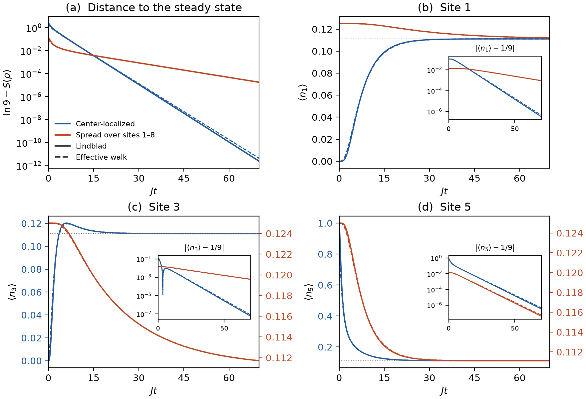

# Detecting the quantum Mpemba effect at a single site

This example reproduces Fig. 1(a–d) on page 014311-4 of Bagui, Chatterjee and Agarwalla, *Physical Review B* **114**, 014311 (2026). An initially localized particle has farther to relax than a spread-out mixture. Yet the localized state reaches equilibrium faster. The site where one measures the occupation determines whether one can see the difference. [Paper](https://doi.org/10.1103/m4wy-kdc9) · [Published Fig. 1 and caption](https://journals.aps.org/prb/pdf/10.1103/m4wy-kdc9#page=4)



The open chain has nine sites, nearest-neighbor hopping `J = 1`, and dephasing jumps `sqrt(5) |i><i|`. One initial state is localized at site 5. The other is an equal incoherent mixture on sites 1–8. Particle number is conserved, so nine site states span the entire physical sector for these inputs.

## Building the matrix-free generator

Encode site `i` as the four-bit representation of `i − 1`. The hopping Hamiltonian connects the first nine basis states along the open chain and has zero matrix elements on the seven unused states. Expand it in Pauli strings once, using the coefficients `Tr(P† H)/16`.

The dephasing jumps also have a simple Pauli representation. Averaging `Z ρ Z` over the 16 products of identities and single-qubit Z operators gives the diagonal of ρ. Thus the 15 nonidentity strings, each with jump amplitude `sqrt(γ/16)`, leave every population unchanged and damp each coherence at rate `γ`, just like the paper's site projectors.

`tc.quantum.Lindblad2PauliStringSum` combines the hopping and jumps into Pauli strings for the generator. `tc.quantum.PauliStringSum2MVP` applies them directly to a flattened density matrix. Both initial states use the same JIT-compiled `mesolve(mode="raw")` function. The four-qubit encoding uses 256 density-matrix entries and avoids building the corresponding 256 × 256 Liouvillian.

## Reading the figure

Color identifies the initial state. Solid lines show the full Lindblad equation, integrated with `tc.timeevol.mesolve(mode="raw")`. The summed dephasing terms contribute `-γ ρ[i,j]` to each off-diagonal entry. Dashed lines show the effective population equation (Eq. 7), implemented with `mesolve` and jumps in both directions along every bond at rate `2 J²/γ`.

- **(a)** The entropy deficits at time zero are `log(9)` for the center-localized state and `log(9/8)` for the spread state. The entropy curves cross at `Jt ≈ 14.87` for the Lindblad equation and `15.00` for the effective walk. The published legend labels the localized state in green and the spread state in blue.
- **(b–d)** Across panels (b–d), the occupations digitized from the published figure agree more closely with the effective walk, including the initial drop at site 5. This figure overlays the full Lindblad result so the early-time difference is visible. For sites 3 and 5 the tick colors identify the scale for each state. The insets use one common scale for both states and show absolute deviations from the stationary occupation `1/9`. The slowest mode is odd under reflection about the center. It is absent from the center-localized state and invisible to the site-5 observable. Both states therefore show the same long-time slope at site 5, even though their amplitudes differ.

## Run and verify

Reading the solid strokes and interpolating between dash centers in published Fig. 1(a) gives crossings near `Jt = 14.9` and `15.0`, respectively. In panel (d), the localized state's center occupation at `Jt = 1` reads about `0.53`. The effective walk gives `0.524` and the full Lindblad evolution gives `0.558`. The precision of the graphical readings is limited by the printed line width.

Use a TensorCircuit-NG environment with the JAX backend, Diffrax, SciPy and Matplotlib. From this directory run

```bash
python main.py
python verify.py
```

`outputs/curves.npz` contains the dimensionless time grid, all nine occupations and both entropy deficits. The state axis is ordered as center-localized, then spread. The original system size, rates and time interval `0 ≤ Jt ≤ 70` are retained.

`verify.py` checks both density matrices at all 1,401 times against an independent matrix exponential built from the nine site projectors. It also checks for leakage into unused states and compares the effective walk with its normal modes.

`verify.py` fits the slope of `log|⟨nᵢ⟩ − 1/9|` over `50 ≤ Jt ≤ 68` for both models. In the full Lindblad dynamics, the localized state decays at `0.1923 J` at all three sites. The spread state decays at `0.0486 J` at sites 1 and 3 and at `0.1923 J` at site 5. The effective walk gives the same site dependence, with rates near `0.1872 J` and `0.0482 J`.
