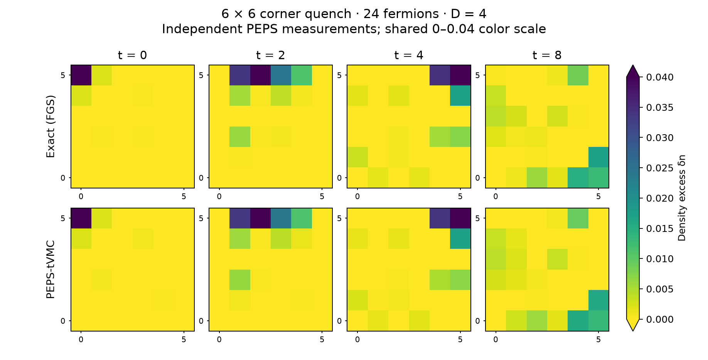

# Fermionic PEPS-tVMC

A scaled reproduction of Figure 2(b,c) in **Yantao Wu and Jannes Nys, “Real-Time Dynamics in Two Dimensions with Tensor Network States via Time-Dependent Variational Monte Carlo Method”**, [arXiv:2512.06768](https://arxiv.org/abs/2512.06768), [PRX Quantum 7, 033035 (2026), DOI: 10.1103/tggc-8fjx](https://doi.org/10.1103/tggc-8fjx).

The example uses a **6 × 6 open Hofstadter lattice, 24 fermions and D=4**, evolved to t=8. The paper uses 12 × 12 sites and reaches t=12. At flux 1/3, this example spans only two magnetic unit cells across the lattice, so it primarily tests PEPS-tVMC against exact densities after a corner quench; it does not establish separated edge and bulk behavior or chiral edge propagation at the paper's scale.

## Run

Use an environment with TensorCircuit-NG, JAX, NumPy, Matplotlib, TenCirPauli and OMECO; verification also uses SciPy. From the repository root:

```bash
example=examples/reproduce_papers/2026_peps_tvmc_chern_edge
CUDA_VISIBLE_DEVICES=0,1,2,3 PYTHONPATH=. python "$example/main.py"
PYTHONPATH=. python "$example/main.py" --plot-only
PYTHONPATH=. python "$example/verify.py" --output "$example/outputs"
```

Select the visible devices for the available machine. Independent chains are shared across them; their count must be divisible by the device count. The default calculation targets GPUs. `--output <directory>` selects another output directory; otherwise paths are relative to the script.

The default run took **21 min 18 s on four NVIDIA A800 GPUs**, from process launch through the saved data and figure, including compilation, VMC preparation, evolution and all four independent measurements.

`main.py` generates both `outputs/summary.npz` and `outputs/result.png`. It starts from seeded random D=2 tensors, performs 100 imaginary-time VMC updates, enlarges the bond to D=4, then performs 100 coarse and 60 refinement updates. All preparation steps use dt=0.05. Real-time evolution uses 40 RK4 steps with dt=0.2, 10,240 chains and one Metropolis sweep per stage. A sweep proposes 36 uniformly selected occupied/empty site swaps, accepted by the PEPS Born weight. No external checkpoint or Gaussian-state fit is required.

Each displayed frame uses 4,194,304 independent Gaussian Born proposals, weighted by its own exactly contracted PEPS amplitude. The raw self-normalized estimate, jackknife uncertainty, infidelity and effective sample size are saved in `summary.npz`. `--plot-only` redraws that file without resimulation.

`--seed` controls all random stages: initialization and chain equilibration use offsets 0–4. Bond-growth noise and measurement proposals retain the published default seeds 7109 and 9147 when `--seed` is 17; both shift by `seed - 17` for other values. The default numerical trajectory and bundled figure are unchanged.

All four density-excess peak positions match the exact solution. At t=8, the density RMSE is 0.000853 and the maximum site error is 0.00210; the RMS measurement standard error is about 0.00022.

## Conventions and scope

- Sites are ordered i=y×6+x, with y increasing upward. Vertical hopping has phase exp(-2πix/3); the upper-left pinning potential is -1 during preparation and removed for real time.
- Particle number is fixed by occupation-conserving sampling. PEPS tensor parity and physical/virtual swap signs follow [arXiv:2506.20106](https://arxiv.org/abs/2506.20106). Arithmetic is complex128.
- OMECO searches once per topology. The resulting exact single-layer path is reused for sampled states, connected states and derivatives, without enumerating the Hilbert space.
- Centered SR has exact gauge-null directions. Positive scalar regularization handles them without an explicit gauge decomposition or projector. The default dense solver stores the covariance; `--solver cg` instead uses matrix-free Fisher products with O(NP) storage and checks the true regularized residual. Dense SR is intended for this 6 × 6 calculation; exact contraction and CG storage alone do not establish 12 × 12 performance.
- Both rows use the same density-excess color scale, 0–0.04. Values outside it saturate visually; saved arrays remain signed and unmodified. Exact contraction does not eliminate preparation, finite-D or stochastic-integration errors.

`verify.py` retains independent charge-sector Hamiltonians, explicit fermionic swap sums, finite-difference derivatives, dense/CG comparisons, Born-distribution checks, Gaussian sampling checks and comparison of RK4 with exact matrix-exponential evolution.


